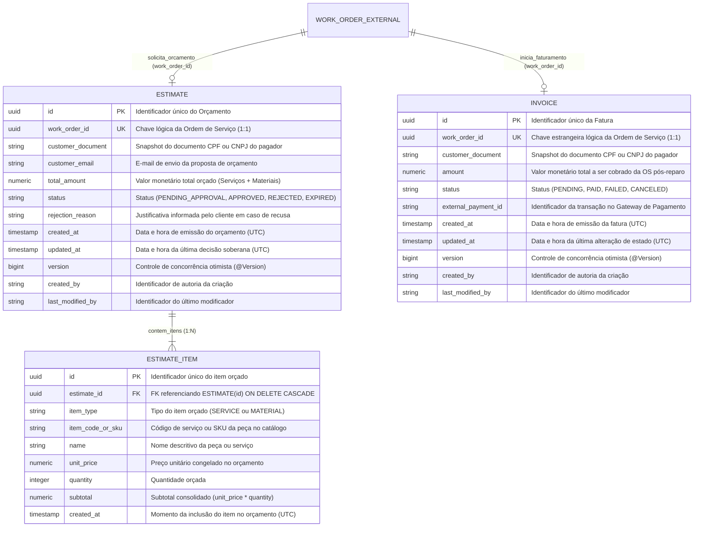

# Diagrama do Modelo de Dados & MER (`15soat-phase4-api-billing`)

Este documento descreve a modelagem de dados relacional do microsserviço de Faturamento, Cobranças e Orçamentos (`billing_db`), implementada em **PostgreSQL** e versionada através de migrações gerenciadas pelo **Flyway** (`db/migration/V1__init_billing_schema.sql` e `db/migration/V2__create_estimate_schema.sql`).

---

## 1. Diagrama Entidade-Relacionamento (MER)

---

## 2. Dicionário de Dados

### 2.1. Tabela: `estimate`

A tabela `estimate` armazena a estimativa preliminar de trabalho levantada pelo mecânico após o diagnóstico, registrando os custos totais e o workflow soberano de aprovação ou rejeição da continuação do serviço pelo cliente.

* **`id`** (`UUID`, Chave Primária): Identificador único imutável do orçamento gerado pela aplicação.
* **`work_order_id`** (`UUID`, NOT NULL, UNIQUE): Referência lógica única à Ordem de Serviço de origem (`api-work-order`). A unicidade assegura que cada OS possua estritamente um orçamento ativo no faturamento.
* **`customer_document`** (`VARCHAR(14)`, NOT NULL): Snapshot do CPF (11 dígitos) ou CNPJ (14 dígitos) do cliente no momento da elaboração do orçamento.
* **`customer_email`** (`VARCHAR(255)`): E-mail do cliente utilizado para envio da notificação com o detalhamento dos custos e o link seguro de decisão.
* **`total_amount`** (`NUMERIC(12, 2)`, NOT NULL, DEFAULT 0.00): Valor monetário total orçado (soma dos subtotais dos itens de serviços e peças).
* **`status`** (`VARCHAR(30)`, NOT NULL): Situação atual do orçamento:
  - `PENDING_APPROVAL`: Orçamento formulado, e-mail disparado e aguardando decisão do cliente.
  - `APPROVED`: Orçamento aceito pelo cliente (dispara liberação da OS para execução na oficina via Kafka).
  - `REJECTED`: Orçamento recusado pelo cliente (dispara cancelamento da OS e estorno de peças).
  - `EXPIRED`: Orçamento cuja validade comercial expirou sem deliberação.
* **`rejection_reason`** (`VARCHAR(500)`): Justificativa opcional informada pelo cliente quando o orçamento é recusado.
* **`created_at`** (`TIMESTAMP WITH TIME ZONE`, NOT NULL, DEFAULT NOW()): Momento de formulação do orçamento em UTC.
* **`updated_at`** (`TIMESTAMP WITH TIME ZONE`, NOT NULL, DEFAULT NOW()): Momento da deliberação ou alteração em UTC.
* **`version`** (`BIGINT`, NOT NULL, DEFAULT 0): Controle de concorrência otimista (JPA `@Version`).
* **`created_by` / `last_modified_by`** (`VARCHAR(100)`): Rastreamento de auditoria da entidade.

---

### 2.2. Tabela: `estimate_item`

A tabela `estimate_item` detalha analyticamente cada peça ou serviço que compõe a estimativa de reparo submetida ao cliente.

* **`id`** (`UUID`, Chave Primária): Identificador único do item orçado.
* **`estimate_id`** (`UUID`, NOT NULL, FK): Referência à tabela pai `estimate` com integridade referencial `ON DELETE CASCADE`.
* **`item_type`** (`VARCHAR(20)`, NOT NULL): Classificação do insumo: `SERVICE` (mão de obra técnica) ou `MATERIAL` (peça/insumo de reposição).
* **`item_code_or_sku`** (`VARCHAR(50)`, NOT NULL): Código do serviço ou SKU da peça no catálogo.
* **`name`** (`VARCHAR(200)`, NOT NULL): Nome descritivo da peça ou serviço congelado no orçamento.
* **`unit_price`** (`NUMERIC(12, 2)`, NOT NULL, DEFAULT 0.00): Preço unitário da peça ou mão de obra no momento da orçamentação.
* **`quantity`** (`INTEGER`, NOT NULL, DEFAULT 1): Quantidade necessária para a execução do serviço.
* **`subtotal`** (`NUMERIC(12, 2)`, NOT NULL, DEFAULT 0.00): Subtotal consolidado calculado por `unit_price * quantity`.
* **`created_at`** (`TIMESTAMP WITH TIME ZONE`, NOT NULL, DEFAULT NOW()): Momento de vinculação do item em UTC.

---

### 2.3. Tabela: `invoice`

A tabela `invoice` é o agregado raiz de quitação final, persistindo a obrigação financeira gerada para o cliente após a conclusão dos reparos na oficina para liquidação online via Mercado Pago.

* **`id`** (`UUID`, Chave Primária): Identificador único imutável da fatura gerado pela aplicação.
* **`work_order_id`** (`UUID`, NOT NULL, UNIQUE): Referência lógica à Ordem de Serviço de origem gerenciada pelo `api-work-order`. A unicidade garante que uma Ordem de Serviço possua rigorosamente uma única fatura emitida, impedindo cobrança duplicada.
* **`customer_document`** (`VARCHAR(14)`, NOT NULL): Snapshot do CPF (11 dígitos) ou CNPJ (14 dígitos) do cliente no momento da cobrança.
* **`amount`** (`NUMERIC(12, 2)`, NOT NULL): Valor monetário exato a ser liquidado junto ao gateway de pagamento (Mercado Pago).
* **`status`** (`VARCHAR(30)`, NOT NULL): Estado atual da fatura:
  - `PENDING`: Aguardando pagamento pelo cliente (QR Code Pix / Checkout gerado).
  - `PAID`: Pagamento confirmado com sucesso pelo gateway de pagamento.
  - `FAILED`: Pagamento recusado, expirado ou reprovado pela instituição financeira.
  - `CANCELED`: Fatura cancelada devido a cancelamento da Ordem de Serviço.
* **`external_payment_id`** (`VARCHAR(100)`): Código de identificação retornado pelo provedor de pagamento (ex: Mercado Pago Payment ID) utilizado para reconciliação e rastreamento em webhooks assíncronos.
* **`created_at`** (`TIMESTAMP WITH TIME ZONE`, NOT NULL, DEFAULT NOW()): Momento de emissão da fatura em UTC.
* **`updated_at`** (`TIMESTAMP WITH TIME ZONE`, NOT NULL, DEFAULT NOW()): Momento da última alteração de status em UTC.
* **`version`** (`BIGINT`, NOT NULL, DEFAULT 0): Controle de concorrência otimista (JPA `@Version`), prevenindo conflitos concorrentes de webhook ou atualização manual.
* **`created_by` / `last_modified_by`** (`VARCHAR(100)`): Rastreamento de auditoria da entidade.

---

## 3. Índices Estratégicos de Performance

Para garantir consultas instantâneas durante as etapas da Saga, nas consultas REST do cliente e no processamento de callbacks de pagamentos, os seguintes índices foram modelados:

| Nome do Índice | Tabela | Coluna(s) | Finalidade / Caso de Uso |
| :--- | :--- | :--- | :--- |
| `idx_estimate_work_order_id` | `estimate` | `work_order_id` | Busca de orçamento por Ordem de Serviço (decisão soberana do cliente). |
| `idx_estimate_status` | `estimate` | `status` | Filtragem de orçamentos pendentes de aprovação e métricas. |
| `idx_estimate_customer_document`| `estimate` | `customer_document` | Histórico e listagem de orçamentos emitidos para o cliente. |
| `idx_estimate_item_estimate_id` | `estimate_item` | `estimate_id` | Junção rápida dos itens detalhados pertencentes a um orçamento. |
| `idx_invoice_work_order_id` | `invoice` | `work_order_id` | Busca de fatura por Ordem de Serviço (Saga & consultas de status). |
| `idx_invoice_status` | `invoice` | `status` | Filtragem de faturas por estado (ex: relatórios de pendentes ou auditoria). |
| `idx_invoice_external_payment_id` | `invoice` | `external_payment_id` | Rápida localização da fatura ao receber Webhooks do Mercado Pago. |
