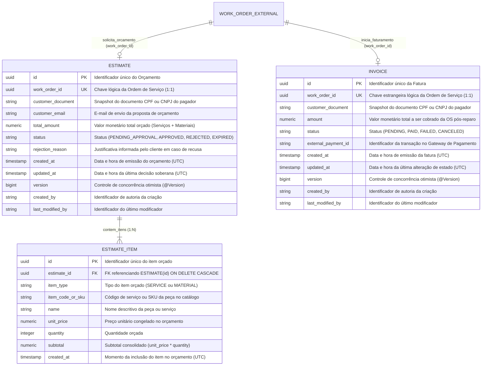

# ADR 0002: Adoção do PostgreSQL Relacional (`billing_db`) para Conformidade Contábil, Faturamento ACID e Idempotência

* **Status**: Aceito (Accepted)
* **Data**: 2026-10-02
* **Escopo**: Microsserviço de Faturamento e Cobranças (`15soat-phase4-api-billing`)
* **Herança Arquitetural**: Especializa a **[ADR 0001 da `15soat-phase4-lib-commons`](../../../15soat-phase4-lib-commons/docs/adr/0001-database-per-service-and-polyglot-persistence.md)** (Padrão Database-per-Service e Persistência Poliglota)
* **Autores**: FIAP SOAT Tech Challenge Team
* **Decisores Técnicos**: Equipe de Arquitetura e Engenharia de Software

---

## 1. Contexto e Declaração do Problema

O microsserviço `15soat-phase4-api-billing` é responsável pela governança financeira do ecossistema da oficina, gerenciando o ciclo de vida de propostas de orçamento preliminar (`estimate`), emissão de faturas consolidadas (`invoice`), geração de ordens de pagamento Pix via gateway externo (Mercado Pago) e liquidação por reconciliação assíncrona de webhooks.

As características desse domínio impõem requisitos inegociáveis de persistência:
1. **Rigor Contábil e Financeiro (ACID Estrito)**: Uma fatura ou pagamento não pode sofrer inconsistências de arredondamento, estados parciais ou anomalias de concorrência que permitam duplo pagamento (*double-spending*) ou faturamento duplicado para uma mesma Ordem de Serviço.
2. **Idempotência no Processamento de Webhooks e Faturas**: Gateways de pagamento externos operam sob semântica de entrega *at-least-once*, podendo disparar o mesmo webhook de confirmação de pagamento múltiplas vezes. A persistência deve garantir de forma atômica que eventos repetidos sejam processados como operações idempotentes (no-op) sem corromper o estado contábil.
3. **Soberania do Ciclo de Aprovação de Orçamento**: O orçamento preliminar levantado pela oficina requer decisão soberana do cliente (`APPROVED` ou `REJECTED`), com registro imutável do snapshot de valores acordados por item (`estimate_item`).
4. **Auditabilidade Fiscal e Temporal**: Necessidade de trilha de auditoria contendo timestamps de criação, alteração de estado e autoria (`created_by`, `last_modified_by`).

---

## 2. Decisão Arquitetural

Decidimos adotar o **PostgreSQL** como o sistema gerenciador de banco de dados relacional (RDBMS) exclusivo do microsserviço `15soat-phase4-api-billing`, operando sob a instância isolada **`billing_db`**:

1. **Padrão Database-per-Service e Desacoplamento Contábil**:
   - O `billing_db` é completamente isolado dos bancos de ordens de serviço (`work_order_db`) e de execução de oficina (`exec_db`). Nenhuma outra aplicação possui credenciais ou acesso de rede direto ao banco financeiro. A correlação entre uma fatura/orçamento e uma OS é mantida estritamente através do identificador lógico imutável `work_order_id` (UUID).
2. **Tabelas Relacionais Normalizadas e Constraints de Unicidade**:
   - A tabela `estimate` impõe constraint de unicidade (`UNIQUE(work_order_id)`), assegurando que não existam múltiplos orçamentos ativos competindo para a mesma ordem de serviço.
   - A tabela `estimate_item` é vinculada à tabela `estimate` via foreign key física com `ON DELETE CASCADE`, garantindo a integridade dos itens orçados (serviços e materiais).
   - A tabela `invoice` mantém unicidade lógica por ordem de serviço (`UNIQUE(work_order_id)`) e registra o identificador externo da transação no Gateway (`external_payment_id`).
3. **Idempotência Transacional via Máquina de Estados e Concorrência Otimista**:
   - A idempotência de webhooks de pagamento do Mercado Pago é implementada no nível de aplicação e transação de banco de dados: a entidade `Invoice` utiliza controle de concorrência otimista com `@Version (BIGINT)` e validação de transição de estado. Notificações repetidas para uma fatura já marcada como `PAID` são imediatamente reconhecidas e tratadas como operações idempotentes bem-sucedidas (HTTP 200 OK) sem alteração de registros no banco.
4. **Versionamento e Governança de Esquema via Flyway**:
   - O ciclo de vida do schema é estritamente versionado por migrações Flyway:
     - `V1__init_billing_schema.sql`: Estrutura nuclear de faturamento e faturas (`invoice`).
     - `V2__create_estimate_schema.sql`: Estrutura do ciclo de aprovação/rejeição de orçamentos preliminares (`estimate`) e seus itens orçados (`estimate_item`).
5. **Precisão Numérica de Ponto Fixo (`NUMERIC(12, 2)`)**:
   - Todos os atributos de valores monetários (`amount`, `total_amount`, `unit_price`, `subtotal`) são tipados como `NUMERIC(12, 2)`, evitando problemas de precisão inerentes a tipos de ponto flutuante (`FLOAT`/`DOUBLE`).
6. **Pool de Conexões Confiável (HikariCP)**:
   - Configuração de pool enxuto e resiliente com desativação do *Open Session in View*, dimensionado para tolerar picos de chamadas de webhook sem exaustão de conexões no PostgreSQL.

---

## 3. Diagrama Entidade-Relacionamento (MER)

---

## 4. Consequências

### Positivas
- **Imutabilidade e Segurança Contábil**: Assegura que faturas liquidadas não possam sofrer mutações acidentais de valores monetários.
- **Prevenção de Duplo Pagamento**: Constraints de unicidade `UNIQUE(work_order_id)` no banco e controle de concorrência `@Version` protegem contra requisições simultâneas de liquidação.
- **Idempotência Robusta**: Garante resiliência operacional perante reenvios automáticos de webhooks pelo gateway externo através de validação de estado e transações atômicas.
- **Rastreabilidade e Compliance**: Histórico temporal completo entre proposta de orçamento (`estimate`), itens congelados (`estimate_item`) e compensação bancária (`invoice`).

### Trade-offs & Mitigações
- **Chaves Estrangeiras Lógicas (Cross-Service)**: O `billing_db` não possui FK física apontando para a tabela `work_order` (que reside no `work_order_db`). *Mitigação*: A integridade é garantida no nível de aplicação através da coreografia de eventos do Apache Kafka (`WorkOrderCompletedEvent` inicia o faturamento e `PaymentConfirmedEvent` notifica a oficina).
- **Sobrecarga de Migrações Flyway**: Toda alteração de schema contábil requer migrations SQL testadas. *Mitigação*: Suíte de testes de integração com Testcontainers PostgreSQL validando migrações e concorrência na pipeline de CI.

---

## 5. Referências Canônicas

- **ADR Global 0001 (`15soat-phase4-lib-commons`)**: *Padrão Database-per-Service e Persistência Poliglota (PostgreSQL + MongoDB)*.
- **ADR Local 0001 (`15soat-phase4-api-billing`)**: *Processamento Idempotente de Webhooks de Pagamento e Publicação de Faturas*.
- **Martin Fowler**, *Accounting Patterns* & *Money Pattern* (Padrões de Representação Monetária e Integridade de Faturamento).
- **Chris Richardson**, *Microservices Patterns: With examples in Java* (Manning), Padrão *Transactional Outbox / Idempotent Consumer*.
- **PostgreSQL Global Development Group**, *PostgreSQL Documentation: Arbitrary Precision Numbers (`NUMERIC` type)*.
